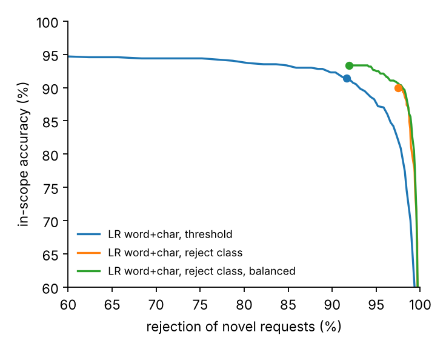
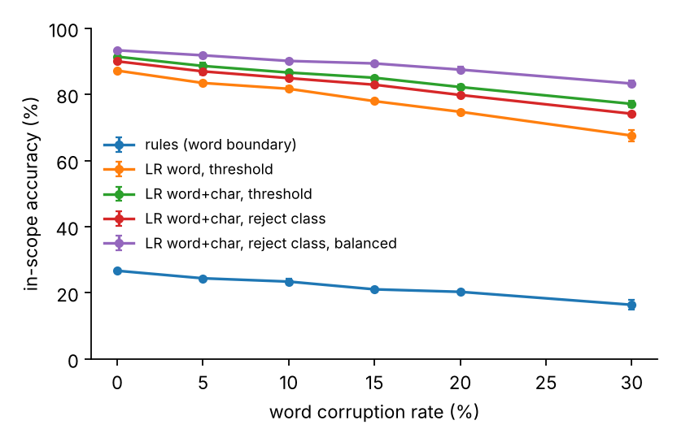
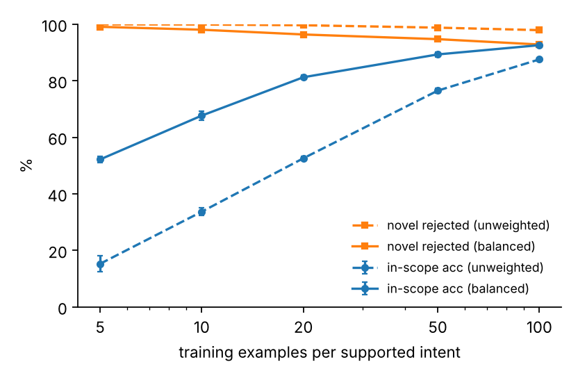

# Intent detection experiments

This is the write-up for `experiments/run_benchmark.py`. Everything here can
be regenerated with

```bash
pip install -r requirements-dev.txt
python experiments/run_benchmark.py      # ~2-3 min on a laptop CPU
```

which writes `results/results.json` and the three figures below.

## Why bother

The 2023 version of ARIA (our minor project) routed commands with a chain of
`if "weather" in query` checks. It worked in the demo because we knew exactly
what to say, but it has two obvious weaknesses:

1. It missed perfectly normal phrasings ("will it rain tomorrow?" has
   no keyword in it).
2. It did the wrong thing for requests it didn't support. Anything with
   "what is" went to the calculator, anything with "open" opened a website,
   "stop" anywhere in a sentence quit the program, and everything else got
   thrown at Google.

The second one is the more interesting problem. A personal assistant only
supports a handful of skills, so most of what people *could* say is out of
scope, and the assistant needs to notice that instead of picking the closest
skill. So the questions here are:

- **Q1.** How much does a small learned classifier improve on the keyword router?
- **Q2.** What's the best cheap way to reject unsupported requests, and does it
  hold up on kinds of requests it never saw during training?
- **Q3.** How badly do transcription errors hurt each approach?
- **Q4.** How much training data does each intent need?
- **Q5.** Is it fast enough to sit in a real-time voice loop on a laptop?

## Setup

**Data.** [CLINC150](https://github.com/clinc/oos-eval) (Larson et al., 2019):
150 intents × 100 train / 20 val / 30 test utterances, plus 1,200
out-of-scope queries. 18 CLINC intents map onto ARIA's 17 supported intents
(`what_is_your_name`, `who_made_you` and `are_you_a_bot` all become `about`;
note that CLINC's `reminder` means *reading* reminders, and
`reminder_update` is the one that sets them). The remaining 132 intents are
things ARIA can't do (banking, travel, cooking, ...).

Those 132 are split in half with a fixed seed:

| test group | what it is | test utterances |
|---|---|---:|
| in-scope | ARIA's intents | 540 |
| seen unsupported | 66 CLINC intents whose *training* examples may be used as negatives | 1,980 |
| unseen unsupported | the other 66, never used in training or tuning | 1,980 |
| CLINC oos | CLINC's own out-of-scope set | 1,000 |

The "unseen" group is the important one: it checks whether a reject class
learned from some unsupported requests generalises to different ones, which
is the realistic situation.

**Systems.**

| name | what it is |
|---|---|
| rules (substring, original) | the 2023 keyword router, unchanged |
| rules (word boundary) | same keywords but matched as whole words |
| LR word, threshold | TF-IDF word 1–2 grams + logistic regression, trained on in-scope only, reject if max prob < t |
| LR word+char, threshold | as above plus char 2–5 grams |
| LR word+char, reject class | trained with an extra `oos` class built from the seen-unsupported intents + CLINC `oos_train` |
| …, balanced | same, with `class_weight="balanced"` |
| SVM word+char, reject class | linear SVM, Platt-calibrated so it has probabilities |

The rejection threshold *t* for each model is picked on the validation set
(maximising the harmonic mean of in-scope accuracy and rejection rate), never
on test. Validation never includes unseen-unsupported intents.

**Metrics.** *In-scope acc* counts a supported request as correct only if it
gets the right intent (rejecting it is wrong). *Reject* columns are the share
of each unsupported group that was correctly rejected. *H-mean* is the
harmonic mean of in-scope accuracy and rejection of *novel* requests (unseen
unsupported + CLINC oos), i.e. how well you do on what you couldn't have
trained for. Numbers are mean ± std over 3 random seen/unseen splits.

## Q1 + Q2: main results

| System | In-scope acc | Reject: seen unsupp. | Reject: unseen unsupp. | Reject: CLINC oos | H-mean |
|---|---:|---:|---:|---:|---:|
| rules (substring, original) | 28.8 | 91.1 ± 1.3 | 90.9 ± 1.3 | 87.5 | 43.6 ± 0.1 |
| rules (word boundary) | 26.7 | 92.8 ± 0.8 | 91.8 ± 0.8 | 88.7 | 41.2 ± 0.1 |
| LR word, threshold | 87.2 | 87.1 ± 0.4 | 88.4 ± 0.4 | 88.0 | 87.7 ± 0.1 |
| LR word+char, threshold | 91.4 | 89.6 ± 0.6 | 91.6 ± 0.6 | 93.2 | 91.8 ± 0.2 |
| LR word+char, reject class | 89.6 ± 0.3 | **99.5** | 97.4 ± 0.6 | 98.3 ± 0.2 | **93.5 ± 0.2** |
| LR word+char, reject class, balanced | **93.6 ± 0.2** | 97.5 ± 0.3 | 92.5 ± 0.8 | 92.8 ± 0.8 | 93.1 ± 0.4 |
| SVM word+char, reject class | 86.8 ± 1.3 | 99.6 ± 0.1 | **98.0 ± 0.2** | **98.6 ± 0.2** | 92.2 ± 0.6 |

(Rows without ± have zero variance: the seed only changes which unsupported
intents count as "seen", and the threshold-only models never look at those.)

What I take from this:

- **The keyword router only gets 29% of supported requests right.** Its high
  rejection numbers aren't a strength, it just doesn't fire on most things.
  Matching whole words removes the embarrassing bugs (quitting on "bus
  stops") but loses a couple of lucky substring hits, so in-scope accuracy
  actually drops slightly.
- **Character n-grams help across the board** (+4.2 in-scope, +3.9 rejection of
  novel requests over word-only), and they matter even more once noise comes in (Q3).
- **An explicit reject class generalises.** Trained only on the "seen" half of
  unsupported intents, it still rejects 97.4% of the *unseen* half, versus
  91.6% for a tuned threshold. The cost is about 2 points of in-scope
  accuracy, mostly from short supported requests being pulled into `oos`.
- **Class balancing moves along the same trade-off rather than beating it.**
  It gives the best in-scope accuracy (93.6) but rejects less of the unseen
  stuff, ending up at a similar H-mean. See the curve below.
- The calibrated SVM is the most conservative: best rejection, worst in-scope.



*Each curve sweeps the confidence threshold on the test set; dots are the
thresholds actually picked on validation.*

## Q3: robustness to transcription errors

There's no audio here, so this uses a synthetic corruption model
(`experiments/noise.py`): each word is hit with probability *p* by a
sound-alike substitution ("weather" → "whether", "set" → "sit"), a deletion,
two words merging, a split, or a spelling error. This isn't meant to
reproduce any particular recogniser; it's a controlled way to compare how
fragile the models are relative to each other. In-scope test set only, mean
of 3 corruption seeds:

| System | 0% | 10% | 20% | 30% | drop at 30% |
|---|---:|---:|---:|---:|---:|
| rules (word boundary) | 26.7 | 23.4 | 20.3 | 16.4 | −10.3 |
| LR word, threshold | 87.2 | 81.7 | 74.7 | 67.5 | −19.7 |
| LR word+char, threshold | 91.4 | 86.6 | 82.2 | 77.1 | −14.3 |
| LR word+char, reject class | 90.0 | 84.9 | 79.8 | 74.2 | −15.8 |
| LR word+char, reject class, balanced | 93.3 | 90.1 | 87.5 | 83.3 | **−10.0** |



Char n-grams cut the degradation roughly in half compared to word-only
features, which is what you'd hope since most of the corruptions only damage
part of a word. The unweighted reject-class model degrades a bit faster than
the threshold model: a garbled request looks unfamiliar, and with ~6.7k
negative examples vs 100 per supported intent the model's default for
"unfamiliar" is `oos`. Balancing the classes fixes most of that. For a voice
assistant this is the deciding factor, which is why the shipped model is the
balanced one (see below).

## Q4: how much data per intent

Reject class kept at full size, number of training examples per supported
intent varied:

| examples / intent | 5 | 10 | 20 | 50 | 100 |
|---|---:|---:|---:|---:|---:|
| in-scope acc, unweighted | 15.3 | 33.7 | 52.6 | 76.5 | 87.5 |
| in-scope acc, balanced | 52.2 | 67.7 | 81.2 | 89.3 | 92.6 |
| novel rejected, unweighted | 99.9 | 99.9 | 99.6 | 98.8 | 97.9 |
| novel rejected, balanced | 99.1 | 98.0 | 96.4 | 94.7 | 92.8 |



Without balancing, a skill with only a handful of examples basically never
wins against the huge `oos` class. With balancing, ~20 examples gets you to
the low 80s. This matters for ARIA because the intents CLINC doesn't cover
(news, open website, web search, email, screenshot, motivation) only have
15–25 hand-written examples each in `data/aria_extra.tsv`.

## Q5: latency

Single utterance, one at a time (the way the voice loop calls it), on the
CPU this was run on:

| System | p50 | p95 |
|---|---:|---:|
| rules | 0.04 ms | 0.06 ms |
| LR word+char | ~1.1 ms | ~1.3 ms |
| SVM word+char (calibrated) | ~3.6 ms | ~4.1 ms |

Speech recognition itself takes hundreds of milliseconds, so the classifier
is irrelevant to perceived latency. The saved model is about 9 MB (mostly the
char n-gram vocabulary) and takes about a second to load at start-up.

## Error analysis

Using the reject-class LR model on the test set.

**Supported requests that got rejected** were mostly short or oddly phrased:
`play_music` (9 of 30), `volume` (7), `help` (6), `reminder` (6). Examples
from CLINC's `play_music` are things like "can x's music be played", which
don't look much like each other.

**Unsupported requests that got accepted** are almost all near neighbours of a
real skill:

| CLINC intent (unsupported) | routed to | count / 30 |
|---|---|---:|
| `timezone` | time | 11 |
| `user_name` | about | 8 |
| `smart_home` | weather | 8 |
| `next_song` | play_music | 7 |
| `change_ai_name` | about | 6 |

These are arguably the right confusions to make: "what time is it in Tokyo"
*is* about time, ARIA just can't do time zones. A bag-of-n-grams model can't
separate "set the thermostat to 22" from weather talk without examples of
both. Adding these as explicit negatives (or just implementing time zones)
would be the obvious next step.

## What runs in the app

`python -m aria.train` trains the **balanced, word+char LR with a reject
class** on CLINC train + val (without the unseen-unsupported intents) plus
`data/aria_extra.tsv`, with a confidence floor of 0.25. Below that, or if
the model predicts `oos`, ARIA says it can't help and *asks* before running a
web search, instead of opening Google on its own.

I went with the balanced model over the one with the best H-mean because a
wrongly rejected request costs one "want me to search that?" turn, while
the unweighted model's extra rejections land on exactly the cases a voice
assistant sees most (noisy transcripts, skills with little data).

## Limitations

- CLINC is typed, crowdsourced text, not transcribed speech. The noise model
  is a stand-in. A proper evaluation would record people speaking the test
  set (or use a spoken dataset like SLURP) and run it through the real STT.
- English only. The original target users were in India and code-mixed
  Hindi/Bengali-English is common; none of that is tested.
- The extra intents in `aria_extra.tsv` were written by me and aren't part of
  any number above, so their accuracy is unmeasured.
- Slot extraction is regex-based and only covered by unit tests, not a
  benchmark.
- Only linear models. A small sentence-embedding model would probably do
  better on paraphrases; the question would be whether it's worth the size
  and start-up time on a laptop.

## References

- S. Larson et al., *An Evaluation Dataset for Intent Classification and
  Out-of-Scope Prediction*, EMNLP-IJCNLP 2019.
- D. Hendrycks and K. Gimpel, *A Baseline for Detecting Misclassified and
  Out-of-Distribution Examples in Neural Networks*, ICLR 2017 (max-softmax
  thresholding).
- E. Bastianelli et al., *SLURP: A Spoken Language Understanding Resource
  Package*, EMNLP 2020.
